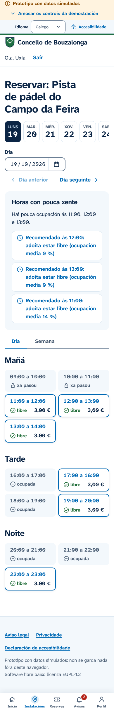
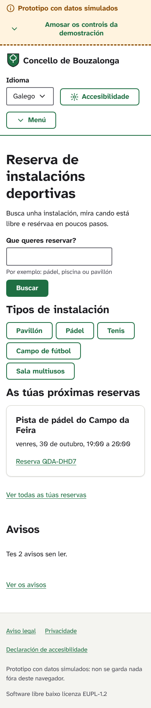
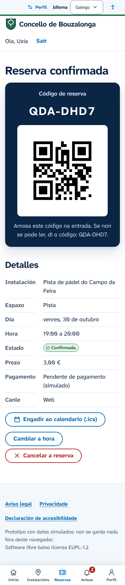
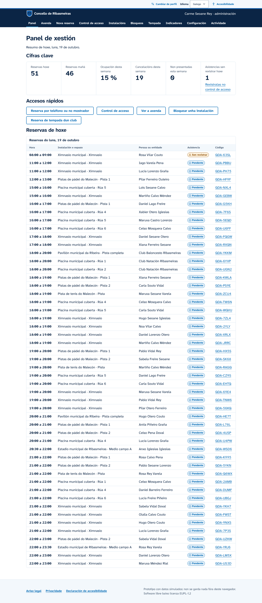

# Quenda

> **Prototipo con datos simulados.** Non hai servidor: os datos gárdanse no teu navegador e volven ao estado inicial ao reiniciar a demostración.

Quenda (en galego, «turno») é unha plataforma libre para reservar as instalacións deportivas municipais, pensada para concellos e deputacións. A veciñanza consulta e reserva desde o móbil; o concello xestiona instalacións, horarios, normas e reservas por teléfono; e a deputación ofrece o servizo a varios concellos desde unha soa instalación. Está deseñada para cumprir as WCAG 2.1 AA desde o primeiro compoñente.

Proposta para o **I Certame GOBTEC de Software Libre**.

**Demostración:** <https://dacalite.github.io/quenda/>



## Que se pode facer

**Cidadanía**

- Buscar instalacións por tipo, día, franxa, accesibilidade física ou dispoñibilidade inmediata.
- Ver a dispoñibilidade como lista de franxas, con recomendación das horas con menos xente.
- Reservar, cambiar e cancelar coas normas e o prezo visibles, e recibir un código QR e o evento para o calendario.
- Consultar o historial e os avisos do concello, como un peche por mantemento que obriga a escoller outra hora.
- Descargar os propios datos e axustar o tamaño do texto, o contraste e o movemento.

**Concello**

- Panel do día, axenda e reservas por teléfono ou no mostrador.
- Instalacións con fotos (co seu texto alternativo), horarios, festivos, normas con herdanza e tarifas, sen código.
- Bloqueos que avisan ás persoas afectadas e reservas de tempada dos clubs con detección de conflitos.
- Control de acceso por QR, indicadores con táboas e CSV, e rexistro de actividade.
- Configuración do nome, escudo, cor de acento (con comprobación de contraste), idiomas e textos legais.

**Deputación**

- Concellos adheridos e indicadores comparados.
- Alta dun concello novo en tres pasos, listo para recibir reservas.

## Deseño

Un só sistema de deseño con dúas superficies. A veciñanza ten unha experiencia de aplicación móbil: barra de lapelas, franxas en tarxetas, as reservas como billetes e o código QR nun pase listo para amosar na entrada. O persoal do concello e a deputación traballan nunha interface máis densa, con táboas compactas e unha barra de navegación corporativa.

As cores son as da Xunta e de Galicia: branco, azul celeste e azuis escuros, coa banda diagonal da bandeira como único elemento decorativo. A cor de cada concello vai como acento no escudo e na cabeceira. Os contrastes de todas as parellas de cores compróbanse en tests, tamén no modo de alto contraste.

## Probalo

Ao entrar escóllese como ver a demostración: cidadanía, persoal do concello ou deputación. Despois, o botón «Cambiar de perfil» da franxa superior permite cambiar de perfil, de persoa e de concello, iniciar unha **visita guiada** e reiniciar os datos.

| Persoa | Perfil                                                              |
| ------ | ------------------------------------------------------------------- |
| Uxía   | 34 anos, empadroada, usa sobre todo o móbil                         |
| Manuel | 72 anos, usa lector de pantalla; o seu perfil activa o texto grande |
| Brais  | 19 anos, non empadroado: ve outra tarifa e outras restricións       |
| Carme  | Administración do concello                                          |
| Xosé   | Conserxería, con axenda, reservas por teléfono e control de acceso  |

Os concellos de Bouzalonga (pequeno e rural) e Ribasmeiras (mediano) e a Deputación de Exemplo son ficticios.

<p>
  
  
  
</p>

Todas as capturas están en [`docs/capturas`](docs/capturas) e xéranse con `npm run screenshots`.

## Executalo

Precisa Node.js 22 ou superior.

```sh
npm ci
npm run dev
```

| Comando               | Que fai                                                              |
| --------------------- | -------------------------------------------------------------------- |
| `npm run dev`         | Servidor de desenvolvemento                                          |
| `npm run build`       | Compilación de produción en `dist/` (`BASE_PATH` para subcartafoles) |
| `npm test`            | Tests unitarios                                                      |
| `npm run e2e`         | Tests no navegador con axe, en escritorio e móbil                    |
| `npm run lint`        | ESLint (con jsx-a11y), Prettier e cabeceiras de licenza              |
| `npm run typecheck`   | Comprobación de tipos                                                |
| `npm run licenses`    | Falla se unha dependencia ten unha licenza non permitida             |
| `npm run api:lint`    | Valida a especificación OpenAPI                                      |
| `npm run screenshots` | Xera as capturas de `docs/capturas`                                  |

## Estrutura

```
src/
  domain/     regras de reserva, prezos, dispoñibilidade, recomendacións e indicadores
  data/       portos (contrato da API), adaptadores local e HTTP, datos de demostración
  app/        estrutura da aplicación, rutas, foco e anuncios
  features/   pantallas de cidadanía, concello, deputación e controis da demostración
  ui/         sistema de deseño accesible
  i18n/       textos en galego e castelán
e2e/          tests no navegador con axe
docs/         documentación técnica
```

## Documentación

- [Visión xeral da arquitectura](docs/arquitectura/vision-xeral.md) e [modelo de datos](docs/arquitectura/modelo-datos.md)
- [Especificación da API (OpenAPI 3.1)](docs/api/openapi.yaml)
- [Interoperabilidade](docs/interoperabilidade.md) e [seguridade e protección de datos](docs/seguridade-rxpd.md)
- [Accesibilidade](docs/accesibilidade/criterios.md): criterios, [informe de probas](docs/accesibilidade/informe-probas.md) e [declaración](docs/accesibilidade/declaracion-accesibilidade.md)
- [Despregamento](docs/despregamento.md)
- [Decisións de arquitectura (ADR)](docs/adr)

## Adaptalo a outro concello

- **Sen código.** Na instancia compartida, a deputación dá de alta o concello desde a súa vista. Despois, a administración do concello completa en «Configuración» o nome, o escudo, a cor, os idiomas, os textos legais e as normas, e dá de alta as instalacións, os horarios e as tarifas.
- **Instancia propia.** O mesmo software pode despregarse nos servidores do concello; os pasos están en [despregamento](docs/despregamento.md).
- **Outro nome para o produto.** Está en `src/config/app.ts`, `package.json` e `index.html`.
- **Outros datos de demostración.** Os concellos, instalacións, clubs e persoas ficticios están en `src/data/seed/catalog.ts`.

## Contribuír

As achegas son benvidas. Le a [guía para contribuír](CONTRIBUTING.md) e o [código de conduta](CODE_OF_CONDUCT.md).

## Licenza

[EUPL-1.2](LICENSE). Software libre: podes usalo, estudalo, modificalo e redistribuílo, e as melloras que publiques seguen sendo libres.
