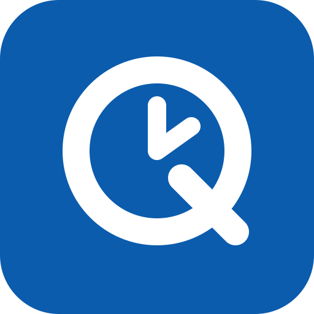
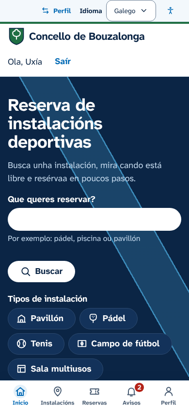
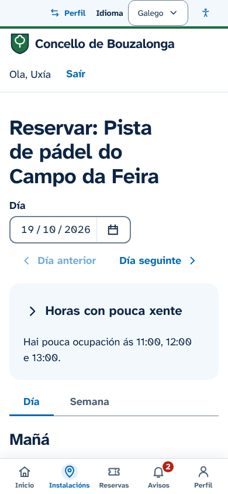
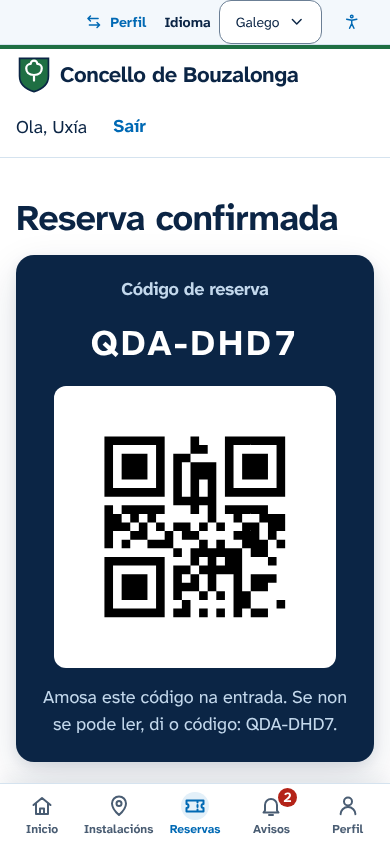
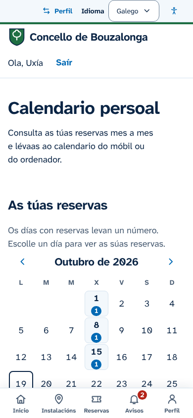
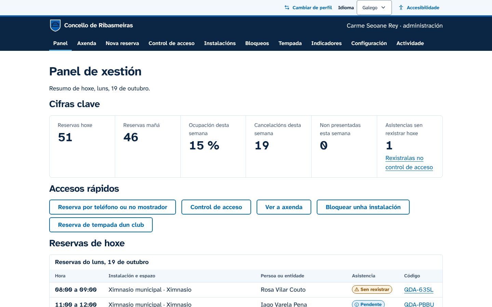
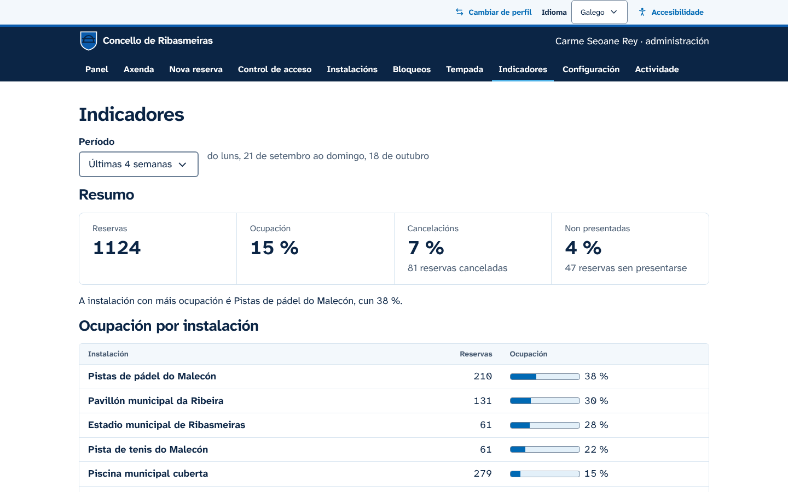
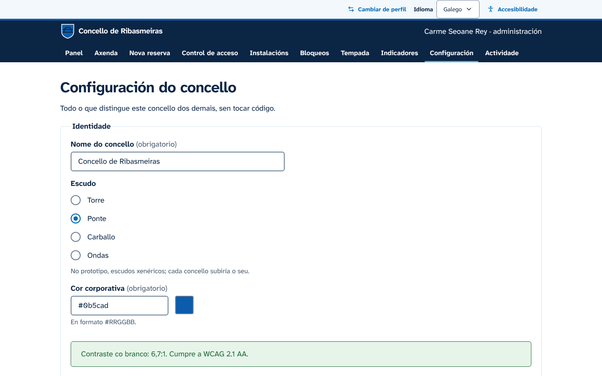
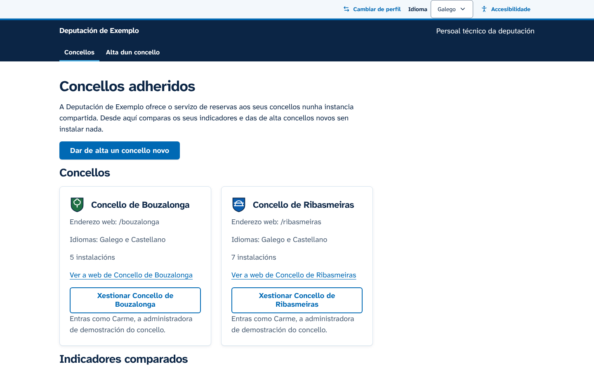

<div align="center">



# Quenda

**Reserva de instalacións deportivas municipais, libre e accesible.**

Proposta para o I Certame GOBTEC de Software Libre

[](LICENSE)
[](docs/accesibilidade/criterios.md)
[](src/i18n)
[](https://github.com/dacalite/quenda/actions/workflows/ci.yml)

**[Probar a demostración](https://dacalite.github.io/quenda/)** · [Ver o vídeo](https://drive.google.com/file/d/17YjD5p25-TKYCOU9gqyLJfKe3WNKlxGY/view) · [Documentación](docs)

https://github.com/user-attachments/assets/5f5f8d98-caa5-49b1-adf3-45ea617f0252

<sub>Vídeo de presentación (35 s). Tamén en [Google Drive](https://drive.google.com/file/d/17YjD5p25-TKYCOU9gqyLJfKe3WNKlxGY/view).</sub>

</div>

> [!NOTE]
> **Prototipo con datos simulados.** Non hai servidor: os datos gárdanse no teu navegador e volven ao estado inicial ao reiniciar a demostración.

Quenda (en galego, «turno») é unha plataforma libre para reservar as instalacións deportivas municipais, pensada para concellos e deputacións. A veciñanza consulta e reserva desde o móbil; o concello xestiona instalacións, horarios, normas e reservas por teléfono; e a deputación ofrece o servizo a varios concellos desde unha soa instalación. Está deseñada para cumprir as WCAG 2.1 AA desde o primeiro compoñente.

## Capturas

<table>
  <tr>
    <td align="center" width="25%"><br><sub>Inicio</sub></td>
    <td align="center" width="25%"><br><sub>Horas libres</sub></td>
    <td align="center" width="25%"><br><sub>Pase con QR</sub></td>
    <td align="center" width="25%"><br><sub>Calendario persoal</sub></td>
  </tr>
</table>

<table>
  <tr>
    <td align="center" width="50%"><br><sub>Panel do concello</sub></td>
    <td align="center" width="50%"><br><sub>Indicadores</sub></td>
  </tr>
  <tr>
    <td align="center"><br><sub>Configuración sen código</sub></td>
    <td align="center"><br><sub>Deputación</sub></td>
  </tr>
</table>

Todas as pantallas completas, en móbil e escritorio, están en [`docs/capturas`](docs/capturas) e xéranse con `npm run screenshots`.

## Que se pode facer

<table>
  <tr>
    <th width="34%">Cidadanía</th>
    <th width="33%">Concello</th>
    <th width="33%">Deputación</th>
  </tr>
  <tr valign="top">
    <td>
      <ul>
        <li>Buscar por tipo, día, franxa, accesibilidade física ou dispoñibilidade inmediata.</li>
        <li>Ver as franxas libres, coas horas de menos xente recomendadas.</li>
        <li>Reservar, cambiar e cancelar coas normas e o prezo visibles, e recibir un QR.</li>
        <li>Calendario mensual coas propias reservas e envío a Google Calendar, Outlook ou .ics.</li>
        <li>Historial, avisos do concello e descarga dos propios datos.</li>
      </ul>
    </td>
    <td>
      <ul>
        <li>Panel do día, axenda e reservas por teléfono ou no mostrador.</li>
        <li>Instalacións con fotos, horarios, festivos, normas e tarifas, sen código.</li>
        <li>Bloqueos que avisan ás persoas afectadas e reservas de tempada dos clubs.</li>
        <li>Control de acceso por QR, indicadores con CSV e rexistro de actividade.</li>
        <li>Nome, escudo, cor, idiomas e textos legais configurables.</li>
      </ul>
    </td>
    <td>
      <ul>
        <li>Concellos adheridos nunha instancia compartida.</li>
        <li>Indicadores comparados entre concellos.</li>
        <li>Alta dun concello novo en tres pasos, listo para recibir reservas.</li>
      </ul>
    </td>
  </tr>
</table>

## Accesibilidade

- **WCAG 2.1 AA**, a referencia da EN 301 549 e do Real decreto 1112/2018.
- **axe en cada pantalla** dos tests de extremo a extremo, en escritorio e móbil: calquera infracción fai fallar o cambio.
- **Todo co teclado e co lector de pantalla**, con foco sempre visible e anuncios dos cambios.
- **Axustes para cada persoa**: tamaño do texto, alto contraste e menos movemento.
- **Gráficas con táboa e resumo en texto**, e a cor nunca como único medio.

Os detalles están nos [criterios e como se cumpre cada un](docs/accesibilidade/criterios.md), no [informe de probas](docs/accesibilidade/informe-probas.md) e na [declaración de accesibilidade](docs/accesibilidade/declaracion-accesibilidade.md).

## Deseño

Un só sistema de deseño con dúas superficies. A veciñanza ten unha experiencia de aplicación móbil: barra de lapelas, franxas en tarxetas, as reservas como billetes e o QR nun pase listo para amosar na entrada. O persoal do concello e a deputación traballan nunha interface máis densa, con táboas compactas e unha barra de navegación corporativa.

As cores son as da Xunta e de Galicia: branco, azul celeste e azuis escuros, coa banda diagonal da bandeira como único elemento decorativo. A cor de cada concello vai como acento no escudo e na cabeceira. Os contrastes de todas as parellas de cores compróbanse en tests, tamén no modo de alto contraste.

## Probalo

Ao entrar escóllese como ver a demostración: cidadanía, persoal do concello ou deputación. Despois, o botón «Cambiar de perfil» da franxa superior permite cambiar de perfil, de persoa e de concello e reiniciar os datos.

| Persoa | Perfil                                                              |
| ------ | ------------------------------------------------------------------- |
| Uxía   | 34 anos, empadroada, usa sobre todo o móbil                         |
| Manuel | 72 anos, usa lector de pantalla; o seu perfil activa o texto grande |
| Brais  | 19 anos, non empadroado: ve outra tarifa e outras restricións       |
| Carme  | Administración do concello                                          |
| Xosé   | Conserxería, con axenda, reservas por teléfono e control de acceso  |

Os concellos de Bouzalonga (pequeno e rural) e Ribasmeiras (mediano) e a Deputación de Exemplo son ficticios.

## Executalo

Precisa Node.js 22 ou superior.

```sh
npm ci
npm run dev
```

<details>
<summary><strong>Todos os comandos</strong></summary>

| Comando               | Que fai                                                              |
| --------------------- | -------------------------------------------------------------------- |
| `npm run dev`         | Servidor de desenvolvemento                                          |
| `npm run build`       | Compilación de produción en `dist/` (`BASE_PATH` para subcartafoles) |
| `npm test`            | Tests unitarios                                                      |
| `npm run e2e`         | Tests no navegador con axe, en escritorio e móbil                    |
| `npm run lint`        | ESLint (con jsx-a11y), Prettier e cabeceiras de licenza              |
| `npm run typecheck`   | Comprobación de tipos                                                |
| `npm run licenses`    | Falla se unha dependencia ten unha licenza non permitida             |
| `npm run api:lint`    | Valida a especificación OpenAPI                                      |
| `npm run screenshots` | Xera as capturas de `docs/capturas`                                  |

</details>

<details>
<summary><strong>Estrutura do código</strong></summary>

```
src/
  domain/     regras de reserva, prezos, dispoñibilidade, recomendacións e indicadores
  data/       portos (contrato da API), adaptadores local e HTTP, datos de demostración
  app/        estrutura da aplicación, rutas, foco e anuncios
  features/   pantallas de cidadanía, concello, deputación e controis da demostración
  ui/         sistema de deseño accesible
  i18n/       textos en galego e castelán
e2e/          tests no navegador con axe
docs/         documentación técnica
```

</details>

## Documentación

| Tema                     | Documentos                                                                                                                                                                    |
| ------------------------ | ----------------------------------------------------------------------------------------------------------------------------------------------------------------------------- |
| Arquitectura             | [Visión xeral](docs/arquitectura/vision-xeral.md) · [Modelo de datos](docs/arquitectura/modelo-datos.md) · [ADR](docs/adr)                                                    |
| API                      | [Especificación OpenAPI 3.1](docs/api/openapi.yaml)                                                                                                                           |
| Interoperabilidade       | [Estándares e formatos](docs/interoperabilidade.md)                                                                                                                           |
| Seguridade e privacidade | [Seguridade e protección de datos](docs/seguridade-rxpd.md)                                                                                                                   |
| Accesibilidade           | [Criterios](docs/accesibilidade/criterios.md) · [Informe de probas](docs/accesibilidade/informe-probas.md) · [Declaración](docs/accesibilidade/declaracion-accesibilidade.md) |
| Despregamento            | [Guía de despregamento](docs/despregamento.md)                                                                                                                                |

## Adaptalo a outro concello

- **Sen código.** Na instancia compartida, a deputación dá de alta o concello desde a súa vista. Despois, a administración do concello completa en «Configuración» o nome, o escudo, a cor, os idiomas, os textos legais e as normas, e dá de alta as instalacións, os horarios e as tarifas.
- **Instancia propia.** O mesmo software pode despregarse nos servidores do concello; os pasos están en [despregamento](docs/despregamento.md).
- **Outro nome para o produto.** Está en `src/config/app.ts`, `package.json` e `index.html`.
- **Outros datos de demostración.** Os concellos, instalacións, clubs e persoas ficticios están en `src/data/seed/catalog.ts`.

## Contribuír

As achegas son benvidas. Le a [guía para contribuír](CONTRIBUTING.md) e o [código de conduta](CODE_OF_CONDUCT.md).

## Licenza

[EUPL-1.2](LICENSE). Software libre: podes usalo, estudalo, modificalo e redistribuílo, e as melloras que publiques seguen sendo libres.

As fotos de exemplo das instalacións teñen as súas propias licenzas Creative Commons, indicadas en [public/photos/CREDITS.md](public/photos/CREDITS.md).
