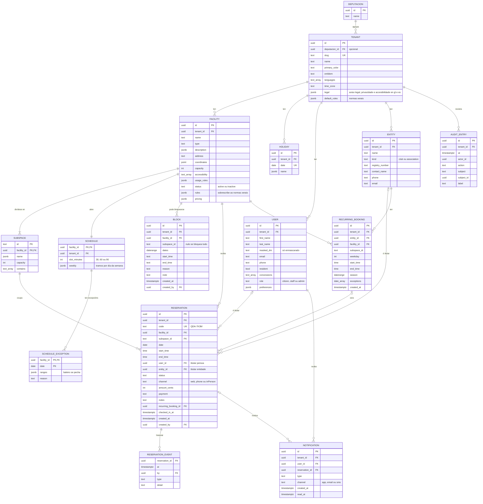

# Modelo de datos

As entidades son as de `src/domain/types.ts`. No sistema completo gárdanse en PostgreSQL; no prototipo, no `localStorage` do navegador, coa mesma forma (`src/data/adapters/local/database.ts`).

## Diagrama entidade-relación



### Notas sobre o modelo

- **Titular dunha reserva.** É unha persoa ou unha entidade, nunca as dúas: unha restrición `CHECK (num_nonnulls(user_id, entity_id) = 1)` garánteo.
- **Espazos que se conteñen.** Un campo enteiro (`full`) contén os dous medios campos. O dominio considera ocupados os espazos relacionados, de modo que non se pode reservar o campo enteiro se un medio xa está collido (`subspacesOverlap` en `src/domain/rules/availability.ts`).
- **Normas con herdanza.** `TENANT.default_rules` son as normas xerais e `FACILITY.rules` só garda as que cambian; `resolveRules` combínaas.
- **Datas e horas locais.** As datas e horas de reservas, horarios e bloqueos son do calendario do concello (`time_zone`); os instantes (`created_at`, `checked_in_at`) gárdanse en UTC.
- **Importes en céntimos** (`int`), para evitar erros de redondeo.
- **Textos en varios idiomas** en `jsonb` co código de idioma como clave (`{"gl": "…", "es": "…"}`).
- **Instalacións que non se borran.** Desactívanse (`status = 'inactive'`) para conservar o historial e os indicadores.
- **Historial e rexistro de actividade.** `RESERVATION_EVENT` garda o que lle pasou a cada reserva; `AUDIT_ENTRY`, quen cambiou que no concello. Ningún dos dous se edita.

## Illamento entre concellos

Todas as táboas dun concello levan `tenant_id`. O illamento ten tres capas:

1. **Na API.** Cada ruta está baixo `/tenants/{tenantId}` e o servidor comproba que a persoa identificada pertence a ese concello.
2. **Na base de datos.** A seguridade por fila de PostgreSQL filtra cada consulta polo concello da petición, aínda que o código se esqueza de facelo:

   ```sql
   ALTER TABLE reservation ENABLE ROW LEVEL SECURITY;
   ALTER TABLE reservation FORCE ROW LEVEL SECURITY;

   CREATE POLICY tenant_isolation ON reservation
     USING (tenant_id = current_setting('app.tenant_id')::uuid)
     WITH CHECK (tenant_id = current_setting('app.tenant_id')::uuid);
   ```

   A API abre cada transacción con `SET LOCAL app.tenant_id = '…'` e conecta cun usuario sen o permiso `BYPASSRLS`.

3. **Nas relacións.** As claves foráneas inclúen o concello, p. ex. `FOREIGN KEY (tenant_id, facility_id) REFERENCES facility (tenant_id, id)`, para que unha reserva non poida apuntar á instalación doutro concello.

A deputación só le os concellos con `deputacion_id` igual ao seu, e os indicadores agregados calcúlanse sen datos persoais.

No prototipo, o adaptador local acouta todas as consultas por concello e un test (`tenant isolation`, en `src/data/adapters/local/repositories.test.ts`) comproba que ningunha devolve filas doutro concello nin permite reservar nel.

Por que esta opción e non unha base de datos por concello está en [ADR 0008](../adr/0008-multitenant-con-rls.md).
